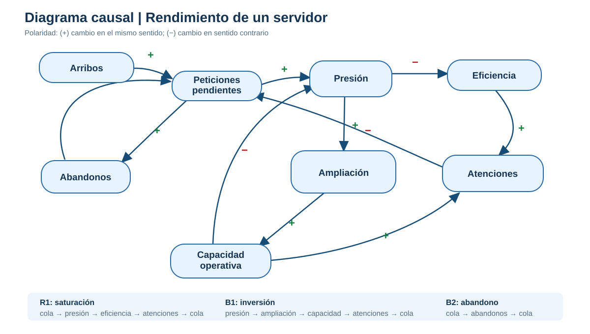
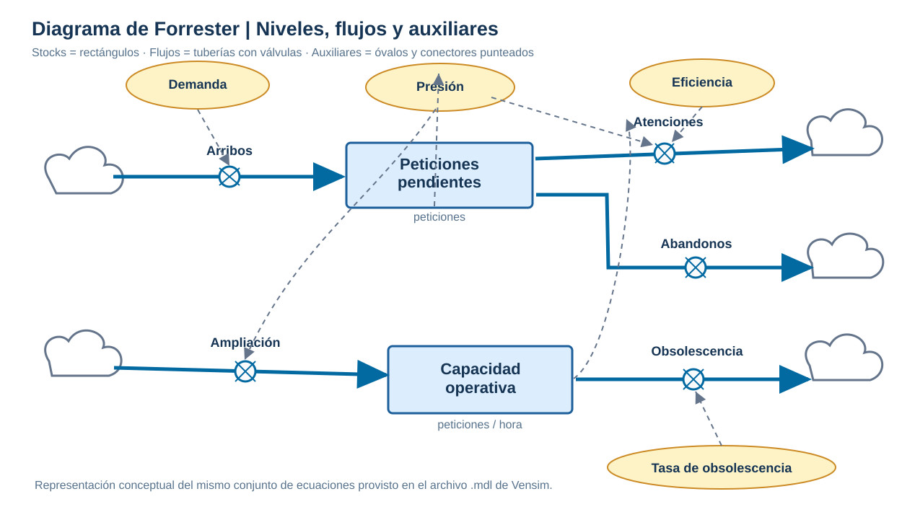

# Laboratorio 3 — Proyecto de simulación

**Materia:** Modelos y Simulación (UNCa). **Caso de partida:** Laboratorio 2, rendimiento de un servidor.  
**Autores:** Franco Sedan Caniza y Joel Bordon Guanco.

> Esta carpeta contiene el desarrollo de los puntos a–h de la consigna. El PDF original **no se incorporó** al repositorio. El modelo es un ejercicio hipotético: no existen mediciones de un servidor real ni calibración estadística.

## a. Título
**Simulación continua del rendimiento de un servidor bajo demanda variable y políticas de ampliación.**

## b. Planteamiento del problema e hipótesis
El Laboratorio 2 modela eventos individuales: peticiones por hora (Poisson), tipos de solicitud y distribuciones de tiempos de respuesta. En este laboratorio reinterpretamos el mismo problema como un **sistema continuo**: cuando la demanda excede la capacidad efectiva, crecen las peticiones pendientes; la congestión disminuye la eficiencia, y algunas peticiones se abandonan. Una política de inversión puede aumentar la capacidad, aunque esta también se deprecia.

**Hipótesis:** frente a un mismo pico de demanda, habilitar la ampliación adaptativa de capacidad **reduce el porcentaje acumulado de peticiones abandonadas** respecto de no ampliar. Como objetivo operativo hipotético se adopta abandono **≤ 15%**. Este SLA **no es el mismo indicador** de latencia que el Laboratorio 2; es una adaptación explícita al modelo continuo.

## c. Definición de variables
| Variable | Tipo | Unidad | Función |
|---|---|---|---|
| Peticiones pendientes, Q | **Nivel (stock)** | peticiones | Solicitudes acumuladas en cola |
| Capacidad operativa, C | **Nivel (stock)** | peticiones/hora | Capacidad instalada que cambia con inversión y desgaste |
| Arribos, A | **Flujo de entrada** | peticiones/hora | Demanda por tramos |
| Atenciones, S | **Flujo de salida** | peticiones/hora | Solicitudes procesadas |
| Abandonos, D | **Flujo de salida** | peticiones/hora | Solicitudes que salen por espera excesiva |
| Ampliación, I | **Flujo de entrada a C** | peticiones/hora² | Capacidad incorporada |
| Obsolescencia, O | **Flujo de salida de C** | peticiones/hora² | Capacidad que se degrada |
| Presión, P | Auxiliar | adimensional | Demanda y cola relativas a la capacidad |
| Eficiencia, E | Auxiliar | adimensional | Reduce la capacidad efectiva bajo saturación |
| Capacidad efectiva | Auxiliar | peticiones/hora | C multiplicada por E |
| Demanda base, pico, horizonte de cola | Constantes | varias | Configuran el sistema |
| % abandono acumulado | Indicador | % | Abandonadas / recibidas × 100 |

**Límites del sistema:** el servidor recibe y procesa solicitudes; se omiten tipos individuales de consulta, concurrencia de procesos, red interna, memoria física y decisiones financieras detalladas. Se representa una capacidad agregada.

## d. Diagrama causal


- **R1, saturación (reforzador):** más cola → más presión (+) → menos eficiencia (−) → menos atenciones (+ entre eficiencia y atenciones) → más cola (− entre atenciones y cola). Dos enlaces negativos producen reforzamiento neto.
- **B1, inversión (balanceador):** más presión → más ampliación → más capacidad → más atenciones → menos cola → menos presión.
- **B2, abandono (balanceador):** más cola → más abandonos → menos cola.
- El desgaste reduce lentamente la capacidad, favoreciendo mayor presión si la demanda se mantiene.

## e. Diagrama de Forrester (Vensim)


Abrí **[modelos/servidor_lab3.mdl](modelos/servidor_lab3.mdl)** con Vensim. El archivo contiene ecuaciones, unidades, condiciones iniciales, parámetros de simulación y un esquema básico de niveles y flujos. El SVG ofrece una versión explicativa más completa de conectores auxiliares. La reproducción visual exacta del SVG dentro de Vensim puede requerir organizar manualmente el sketch. No se verificó este archivo en una instalación local de Vensim.

En Vensim, para comparar los escenarios se cambian las constantes `Activar pico` y `Activar ampliacion`: **(0,0) base**, **(1,0) pico sin ampliación**, **(1,1) pico con ampliación**. Se establece `TIME STEP = 0.05` h, `FINAL TIME = 48` h y método **Euler**.

## f. Formulación de ecuaciones

```text
Q(t + dt) = Q(t) + [A(t) - S(t) - D(t)] * dt       Q(0) = 0
C(t + dt) = C(t) + [I(t) - O(t)] * dt             C(0) = 36

A = demanda_base * (factor_pico si t pertenece a [12,30) y hay pico; sino 1)
P = A/max(1,C) + Q/[max(1,C)*horizonte_cola]
E = 1 / [1 + degradacion * max(0,P-1)]
capacidad_efectiva = C * E
S = min(capacidad_efectiva, A + Q/dt)
D = min(Q/tiempo_abandono, max(0,A + Q/dt - S))
I = min(max_ampliacion, ganancia_inversion * max(0,P-1)) si se activa, sino 0
O = C * tasa_obsolescencia

% abandono = 100 * abandonadas_acumuladas / recibidas_acumuladas
```

Las salidas están limitadas por la disponibilidad de solicitudes; el modelo en navegador aplica además un mínimo numérico de cero a la cola y uno a la capacidad. Para los tres escenarios publicados, esos mínimos no alteran las trayectorias. La identidad de conservación se comprueba con:

```text
Recibidas = Atendidas + Abandonadas + Pendientes finales
```

Parámetros de ejemplo: demanda base 30 peticiones/h, capacidad inicial 36 peticiones/h, factor de pico 2,2 (66 peticiones/h entre las horas 12 y 30), horizonte de cola 4 h, tiempo de abandono 4 h, degradación 0,08, obsolescencia 0,002/h, ganancia de inversión 10 peticiones/h², máximo de ampliación 8 peticiones/h².

## g. Experimentación
Se ejecutaron **tres corridas deterministas** con el mismo horizonte de 48 horas y un paso Euler de 0,05 horas. Cada corrida utiliza las mismas condiciones iniciales. Solo varían la presencia de pico y la política de ampliación. Cifras redondeadas de la implementación JavaScript:

| Escenario | Recibidas | Atendidas | Abandonadas | Máxima cola | Capacidad final | % de abandono | SLA 15% |
|---|---:|---:|---:|---:|---:|---:|---|
| Base (sin pico, sin ampliación) | 1.440 | 1.440 | 0 | 0 | 32,7 | 0,00% | Cumple |
| Pico sin ampliación | 2.088 | 1.476,0 | 612,0 | 144,1 | 32,7 | 29,31% | No cumple |
| Pico con ampliación | 2.088 | 1.995,3 | 92,7 | 46,6 | 64,1 | 4,44% | Cumple |

**Reproducibilidad:** abrir [laboratorio3.html](laboratorio3.html). La página genera la tabla y tres gráficos comparativos (cola, capacidad y abandono acumulado) en tiempo real. No usa datos aleatorios en este laboratorio, porque estudia un modelo dinámico continuo con parámetros controlados.

## h. Análisis de resultados y conclusiones
El pico sin ampliación eleva la cola máxima a aproximadamente **144,1** solicitudes y deja un **29,31%** de abandono acumulado. Al activar la ampliación adaptativa, la cola máxima baja a aproximadamente **46,6**, el abandono a **4,44%** y la capacidad crece hasta unas **64,1** peticiones/h. La reducción es de **24,87 puntos porcentuales** de abandono y, bajo estos supuestos, respalda la hipótesis.

La corrida base tiene abandonos nulos, pero muestra desgaste gradual de capacidad. La inversión no elimina totalmente el pico ni sus consecuencias: responde a la presión con la velocidad de ampliación definida. **No es una predicción de un servidor real.** Antes de una decisión operativa se debe calibrar el modelo, contrastarlo con registros y verificar sensibilidad a parámetros, especialmente el tiempo de abandono, la capacidad efectiva y los costos de expansión.

### Referencias técnicas
- Vensim, función `INTEG`: https://vensim.com/documentation/fn_integ.html
- Vensim, `IF THEN ELSE`: https://vensim.com/documentation/fn_if_then_else.html
- Vensim, formato de sketches `.mdl`: https://www.vensim.com/documentation/ref_sketch_format.html

### Archivos incluidos
- `laboratorio3.html` — aplicación y gráficos.
- `JS/laboratorio3_modelo.js` — motor de simulación independiente.
- `JS/laboratorio3_app.js` — interfaz y gráficos.
- `styles/laboratorio3.css` — diseño responsive.
- `diagramas/causal_lab3.svg` — bucles de retroalimentación.
- `diagramas/forrester_lab3.svg` — niveles y flujos.
- `modelos/servidor_lab3.mdl` — modelo de ecuaciones para Vensim.

El PDF de consigna **no se subió**.

### Presentación visual en Canva

- [Presentación editable: Laboratorio 3 — Dinámica de Sistemas](https://www.canva.com/d/btXe7F9Zt8wmYvU) (11 diapositivas, diagramas y gráficos del modelo).
